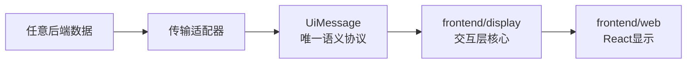

# `frontend/ui-protocol.py` 通用协议

## 目标

本页记录后端消息面。完整的两个协议面与动作核心见[交互核心与两个协议面](interaction-entrypoints.md)。

后端消息入口使用 `UiMessage`，用户入口使用 `UiAction / UiState`。
后端把信息编码成这个消息，`frontend/display` 负责消费和转换，`frontend/web` 决定 React 如何呈现。
CLI 与 React Web 是用户入口，入口适配器负责动作转换。React 是 Web 的 UI 技术栈。HTTP、WebSocket、SSE 是可选的传输实现。



本协议不规定后端的领域模型，也不规定显示层使用什么框架。
因此同一个消息可以来自不同后端，也可以被 CLI、Web 和不同的显示技术消费。

## 行业共识

行业没有一个统一的“后端到前端通用 UI 协议”。可复用的是几组边界和格式共识：

- [Hexagonal Architecture](https://alistair.cockburn.us/hexagonal-architecture)：多个外部适配器通过端口连接同一核心。
- [Clean Architecture 的 Input/Output Boundary](https://www.informit.com/articles/article.aspx?p=2832399&seqNum=2)：入口把外部格式转换为用例数据，核心不接收 HTTP 或 CLI 细节。
- [JSON Schema](https://json-schema.org/specification)：用语言无关的 schema 描述 JSON 数据。
- [JSON:API](https://jsonapi.org/format/index.html)：提供资源、集合、关系和链接的通用语义参考。
- [CloudEvents](https://github.com/cloudevents/spec/blob/main/cloudevents/spec.md)：为事件定义统一元数据和扩展位置。
- [GraphQL response envelope](https://graphql.org/learn/response/)：把数据、错误和扩展分开；GraphQL 本身仍是查询语言，不是本协议。
- [RFC 9457](https://www.rfc-editor.org/rfc/rfc9457.html)：只适用于 HTTP 的问题详情格式，不能成为核心协议的传输依赖。
- [Presentation Model](https://martinfowler.com/eaaDev/PresentationModel.html)：把呈现状态从具体 GUI 控件中分离出来。

因此本项目采用：JSON 兼容的消息信封、类型和 schema 标识、结构化问题、语义呈现提示、命名空间扩展。
本项目不采用 Adaptive Cards 作为核心，因为它把布局和宿主渲染能力带入了协议。

## 消息结构

`UiMessage` 的字段如下：

| 字段 | 含义 |
| --- | --- |
| `protocol` | 协议名。当前为 `lianghua.ui`。 |
| `version` | 协议版本。当前为 `1`。 |
| `message_id` | 消息唯一标识。 |
| `correlation_id` | 可选的请求、事件或流程关联标识。 |
| `kind` | 消息类别。 |
| `type` | 语义类型标识。可以是 URI 或命名空间名称。 |
| `schema` | `data` 的 JSON Schema 标识。 |
| `data` | JSON 值。它是实际业务内容，但协议不解释业务字段。 |
| `presentation` | 可选的语义呈现提示。 |
| `links` | 可选的关系链接。 |
| `extensions` | 可选的命名空间扩展。 |

### 消息类别

| `kind` | 用途 |
| --- | --- |
| `resource` | 一个语义对象。 |
| `collection` | 有顺序的对象集合。 |
| `series` | 有顺序的测量值或时间序列。 |
| `document` | 结构化文档或报告内容。 |
| `operation` | 可执行操作及其输入描述。 |
| `event` | 状态变化、进度或通知。 |
| `problem` | 错误、警告或不可用信息。 |
| `custom` | 需要自定义 schema 的其他消息。 |

`kind` 只回答“这是什么类别”，`type` 和 `schema` 才回答“这个具体消息是什么”。
这样不会把某个业务领域硬编码进核心协议。

## 呈现提示的边界

`presentation` 可以告诉显示层：

- 标题和语义角色；
- 字段路径和用户可读标签；
- 值的格式、单位和精度；
- 字段顺序和可见性。

它不能包含：

- React 组件名、props 或 JSX；
- HTML、CSS、JavaScript 或可执行模板；
- 页面路由、布局树或具体像素尺寸。

显示层仍然拥有最终呈现决定权。后端只能提供语义提示，不能远程控制显示技术。

## 问题消息

`problem` 消息的 `data` 可以使用 `UiProblem`：

```json
{
  "type": "urn:example:validation-error",
  "code": "invalid-input",
  "title": "Invalid input",
  "detail": "The value is not valid.",
  "field": "amount",
  "retryable": false
}
```

入口适配器可以把它转换成 CLI 文本、HTTP Problem Details 或页面错误状态。
这些转换不反向污染 `UiMessage`。

## 自定义扩展

自定义消息必须同时提供：

1. 自定义 `type`；
2. 自定义 `schema`；
3. 必要时提供命名空间扩展；
4. 显示层的显式 renderer/normalizer 注册。

扩展名必须带命名空间，例如 `urn:example:trace` 或 `x-example-trace`。
未知类型必须产生明确的“不支持”状态。不能静默猜测，也不能执行动态代码。

协议版本和 `schema` 版本分开管理。新增可选字段可以向后兼容；已有字段不能换含义。

## Python 文件的职责

`frontend/ui-protocol.py` 是唯一手工维护的公共契约源：

- 前端面：`UiAction / UiState / FrontendPort`。
- 后端面：`UiRequest / UiMessage / BackendPort / UiProtocol.receive`。
- 通用问题、字段提示、关系链接和 JSON 边界校验。
- Pydantic 导出 JSON Schema，端口签名和模型生成 TypeScript。

它不包含 HTTP 路由、CLI 参数、React 控件、领域算法或业务名单。

## 当前落地范围

CLI 和 React Web 已通过前端面接入同一个 TypeScript 核心。浏览器只调用
`POST /api/protocol`，该路由只转发标准 `UiRequest / UiMessage`。后端业务操作由
`src/protocal.py` 装配和分发；旧业务 HTTP 路由已删除。

回测运行时必须提供明确的 `RunFactory`。当前没有兼容旧执行器的 fallback。

核心管理输入、检查、请求和呈现状态。响应信封格式保持 `lianghua.ui` version 1。详见[接线状态与验证](interaction-entrypoints.md)。
